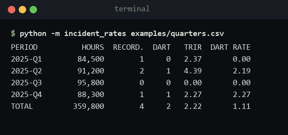

<p align="center"></p>

# osha-incident-rate-calculator

[](https://github.com/yassine2med/osha-incident-rate-calculator/actions/workflows/ci.yml)  

Computes TRIR and DART rates per period and in total from a CSV of hours worked and case counts.



## What it is for

Safety managers on construction and facility teams report Total Recordable Incident Rate (TRIR) and DART rate (days away, restricted or transferred) to owners and bidding portals. They usually keep hours and case counts per quarter in a spreadsheet. This tool turns that CSV into both rates for each period and for the whole range, using the standard base of 200,000 hours, so the numbers on a prequalification form match the records.

## Install

```
git clone <repo-url> osha-incident-rate-calculator
cd osha-incident-rate-calculator
pip install -e .
```

## How to use

| I want to | Command |
|---|---|
| Compute TRIR and DART from a CSV | `python -m incident_rates examples/quarters.csv` |
| Use my own data file | `python -m incident_rates path/to/hours.csv` |
| See the built-in help | `python -m incident_rates --help` |
| Run the tests | `python -m pytest -q` |

The tool takes one CSV and has no other options. Cases come from the `recordable_cases` and `dart_cases` columns.

Worked example:

```
python -m incident_rates examples/quarters.csv
```

```
PERIOD          HOURS  RECORD.  DART   TRIR  DART RATE
2025-Q1        84,500        1     0   2.37       0.00
2025-Q2        91,200        2     1   4.39       2.19
2025-Q3        95,800        0     0   0.00       0.00
2025-Q4        88,300        1     1   2.27       2.27
TOTAL         359,800        4     2   2.22       1.11
```

## How it works

- Rate = cases x 200,000 / hours worked, rounded to 2 decimals.
- TRIR uses recordable_cases. The DART rate uses dart_cases (days away, restricted or transferred).
- The TOTAL row sums hours and cases first, then computes the rate. It does not average the period rates.
- Rows are rejected if hours are zero or less, a count is not a whole number, or DART cases exceed recordable cases.

## Limits

It does not decide whether a case is recordable under 29 CFR 1904. You enter the counts. It does not compare against industry averages. Install pytest with `pip install pytest` to run the tests.

## License

MIT. Copyright 2026 Yassine Emhamed.
